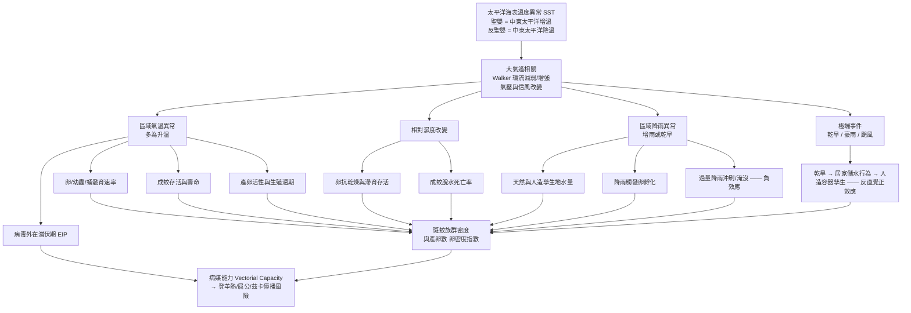

# 聖嬰現象（El Niño / ENSO）如何直接與間接影響環境因子，進而影響斑蚊族群與產卵數：學術文獻回顧

> **文獻來源聲明**：本文獻回顧所引用之生物醫學實證研究，均檢索自 **PubMed / PubMed Central**。所有引用之原始論文皆於文末「參考文獻」章節附上 DOI 連結，以標明原作者與出處。
>
> **全文查核狀態**：24 篇引用文獻中，**15 篇開放取用文獻已取得並逐篇查核全文**，其方法細節、效應量與作者自陳限制整理於[附錄 A](#附錄-a15-篇開放取用論文全文重點與量化證據)；正文相關敘述已據全文修訂（修訂幅度較大者為 4.1、4.2、4.4、6、7、8 節）。**其餘 9 篇為付費牆文獻，敘述仍僅基於摘要**，清單見 [A.5](#a5-尚未取得全文的付費牆文獻9-篇)。
>
> **主要病媒物種**：本文所稱「斑蚊」主要指埃及斑蚊（*Aedes aegypti*）與白線斑蚊（*Aedes albopictus*），二者為登革熱、屈公病（chikungunya）、茲卡病毒（Zika）與都市型黃熱病之主要病媒。**部分引用研究的實測物種並非上述二者**（如布里斯本儲水研究實測 *Ae. notoscriptus*），已於正文與附錄逐一標註。

---

## 摘要

聖嬰－南方振盪（El Niño–Southern Oscillation, ENSO）是地球上跨年際尺度最強的氣候變異訊號。ENSO **並不直接**作用於斑蚊個體，而是透過一條「**海溫異常 → 大氣遙相關 → 區域天氣（溫度、降雨、濕度、乾旱）→ 斑蚊生活史各階段（卵、幼蟲、蛹、成蟲、產卵行為）→ 族群密度與病媒能力**」的因果鏈，間接調控斑蚊族群動態與產卵數。本文系統性整理此因果鏈的每一環節，並以來自台灣、南美洲（秘魯、哥倫比亞、委內瑞拉、巴西）、東南亞（印尼）、非洲與澳洲的實證研究支持各機制。核心結論為：**溫度**是驅動斑蚊發育速率、成蟲存活、產卵活性與病毒外在潛伏期的主導變數；**降雨**是雙面刃——適量降雨提供孳生地並觸發卵孵化，過量降雨則會沖刷幼蟲並淹沒產卵點；**乾旱**在許多地區反而因促進「居家儲水行為」而增加人造容器孳生源。ENSO 對斑蚊的影響具有顯著的**時間滯後（數週至數月）**、**非線性**與**區域依賴性**，此特性正是登革熱早期預警系統得以建立的基礎。

---

## 目錄

1. [概念架構：ENSO 影響斑蚊的因果鏈](#1-概念架構enso-影響斑蚊的因果鏈)
2. [ENSO 的物理機制與遙相關](#2-enso-的物理機制與遙相關)
3. [第一環節：ENSO → 區域環境因子](#3-第一環節enso--區域環境因子)
4. [第二環節：環境因子 → 斑蚊生活史與產卵](#4-第二環節環境因子--斑蚊生活史與產卵)
5. [綜合機制：病媒能力與外在潛伏期](#5-綜合機制病媒能力vectorial-capacity與外在潛伏期)
6. [區域實證案例](#6-區域實證案例)
7. [時間滯後與早期預警](#7-時間滯後lag與早期預警)
8. [調節因子：非線性、社會經濟與都市化](#8-調節因子非線性社會經濟與都市化)
9. [研究限制與未來方向](#9-研究限制與未來方向)
10. [結論](#10-結論)
11. [參考文獻](#11-參考文獻含-doi)
- [附錄 A：15 篇開放取用論文全文重點與量化證據](#附錄-a15-篇開放取用論文全文重點與量化證據)

---

## 1. 概念架構：ENSO 影響斑蚊的因果鏈

ENSO 對斑蚊的作用是**階層式、間接性**的。可將整體機制拆解為下列因果鏈：

**關鍵觀念**：
- **直接影響（斑蚊層級）**：溫度、降雨、濕度等**局部天氣變數**直接作用於斑蚊的生理與行為。
- **間接影響（氣候層級）**：ENSO 本身是**上游氣候驅動力**，透過改變上述局部天氣變數而「間接」影響斑蚊——這也是文獻中反覆出現「ENSO 的效應主要透過局部溫度與降雨中介」的原因（Muñoz 等人於哥倫比亞的研究；Sci Rep 委內瑞拉研究）。

---

## 2. ENSO 的物理機制與遙相關

ENSO 是熱帶太平洋海洋－大氣耦合系統的振盪，具三個位相：**聖嬰（El Niño，暖位相）**、**反聖嬰（La Niña，冷位相）** 與**中性**。其強度常以**海洋尼諾指數（Oceanic Niño Index, ONI）** 量化。

根據 Pirani、Lorenz 等人（2024）涵蓋 São Paulo 州 645 個市鎮、2008–2018 年 44 個季度的貝氏時空階層模型（R-INLA），ENSO 被描述為「地球上最具影響力的大氣現象之一，其特徵為**海洋溫度變化、信風強度與大氣氣壓三者交互作用**，導致氣候條件的大範圍改變」（PLoS Negl Trop Dis, 10.1371/journal.pntd.0012397）。該研究採**保守的 |ONI| ≥ 1°C** 判定聖嬰／反聖嬰（而非慣用的 0.5°C），以因應區域氣候反應的變異性。

聖嬰期間，中、東太平洋海表溫度升高，**Walker 環流減弱**，改變全球大氣的熱力與水氣輸送，透過「**遙相關（teleconnection）**」把太平洋的海溫異常訊號傳遞到遠處陸地，造成不同區域的溫度與降雨異常。值得注意的是：

- ENSO 效應具**區域異質性**——同一次聖嬰事件在不同地區可能表現為升溫增雨或升溫乾旱。
- ENSO 常與**印度洋偶極（Indian Ocean Dipole, IOD）** 共同作用；在南台灣的研究中，IOD 對局部氣候季節性的影響甚至大於 ENSO（PLoS One, 10.1371/journal.pone.0178698）。

因此，理解「ENSO → 斑蚊」必須先確認**該地在特定 ENSO 位相下的具體天氣反應**，不能一概而論。

---

## 3. 第一環節：ENSO → 區域環境因子

ENSO 透過遙相關改變下列對斑蚊有意義的環境因子：

### 3.1 溫度（升溫為主）

多數實證研究指出聖嬰位相伴隨**區域氣溫上升**：
- 印尼 Palembang 的登革大流行（1997 年底–1998 年）期間，ENSO 驅動的環境氣溫較常年高出 **+0.6 至 +1.2°C**，且此升溫在流行前數月即持續存在（Southeast Asian J Trop Med Public Health）。
- 委內瑞拉研究確認登革高峰多出現於「**較暖且較乾**」的聖嬰年（Sci Rep, 10.1038/s41598-018-24003-z）。
- 哥倫比亞研究以非線性因果分析（PCMCI）證實，聖嬰使登革病例增加「**主要由 ENSO 驅動的升溫與降雨減少所解釋**」（Acta Trop, 10.1016/j.actatropica.2021.106136）。

### 3.2 降雨（增雨或減雨，依區域而定）

ENSO 對降雨的影響方向具強烈區域性：
- 在南美安地斯與太平洋沿岸區，聖嬰常伴隨**降雨減少**（哥倫比亞、委內瑞拉）。
- 在秘魯沿海（Costa）與部分低地，聖嬰可帶來**異常豪雨**。
- 巴西 Recife 都會區研究指出，ENSO 造成的「**正溫度異常與降雨減少（源於海表溫度改變）**」為登革流行病學改變的部分成因（Rev Soc Bras Med Trop, 10.1590/0037-8682-0671-2021）。

### 3.3 乾旱與極端事件

聖嬰在部分地區與**嚴重乾旱**高度相關。波多黎各研究記錄到 2014–2015 年強聖嬰事件同時出現乾旱（J Med Entomol, 10.1093/jme/tjad053）。乾旱看似不利於需要水域孳生的斑蚊，但其**間接效應**（透過改變人類儲水行為）反而可能有利於斑蚊——詳見 4.4 節。

### 3.4 相對濕度

濕度隨溫度與降雨變化，並直接影響斑蚊卵的抗乾燥能力與成蟲脫水死亡率（見 4.3 節）。

---

## 4. 第二環節：環境因子 → 斑蚊生活史與產卵

斑蚊為**完全變態昆蟲**，生活史含卵→幼蟲→蛹→成蟲四階段，前三階段皆為水生。環境因子對各階段的作用如下。

### 4.1 溫度：主導性驅動變數

溫度是文獻中最一致、最強的斑蚊族群驅動因子，作用於**多個生活史環節**：

**(a) 卵與胚胎發育**
埃及斑蚊卵於產下時為白色，隨後迅速黑化；卵長 **581.45 ± 39.73 µm**、寬 **175.36 ± 11.59 µm**（長寬比 3.32）。在 **28 ± 1°C** 下胚胎發育於約 **61.6 小時**內完成：初期（0–20.5 h，胚帶延伸、細胞分裂旺盛）、中期（20.6–40.1 h，出現漿膜層與頭胸分節）、末期（40.2–61.6 h，形成破卵刺 egg-burster 與完整體節）。卵的絨毛膜（chorion，分外絨毛膜與內絨毛膜）是重要的保護屏障，其**不透水性極強**——研究者收集約 1,000 顆卵僅約 5%（46 顆）能成功完成組織固定處理，甚至有卵在 3% 次氯酸鈉浸泡 1 小時後仍孵化（Parasit Vectors, 10.1186/s13071-021-05024-6）。此不透水性正是卵抗乾燥、可存活約 1 年的結構基礎，也是防治上最難突破的環節。溫度升高一般加速胚胎發育與孵化。

**(b) 幼蟲／蛹發育速率與成蟲體型**
在適溫範圍內升溫縮短幼蟲與蛹的發育時間，加快世代更替；但體型（vector size）通常隨溫度上升而縮小，間接改變叮咬率（Am J Trop Med Hyg, 10.4269/ajtmh.1997.57.285）。

**(c) 產卵活性（oviposition）**
多項田野研究以誘卵器（ovitrap）證實溫度與產卵正相關：
- 阿根廷中部研究：斑蚊產卵與「**前三週夜間溫度**」呈正相關（Med Vet Entomol, 10.1111/mve.12550）。
- 阿根廷 Córdoba 溫帶研究：**最低溫**與產卵活性正相關，低最低溫是產卵的限制因子（Acta Trop, 10.1016/j.actatropica.2020.105744）。
- 巴西 Paraná 沿海研究：**月均溫**是唯一對產卵有顯著正影響的氣候變數（GLMM，LRT = 16.65, p < 0.001；ß = 1.82 ± 0.42）。**須注意**：降雨、最低／最高溫、最高相對濕度因共線性（r > 0.7）被剔除模型，故「僅溫度顯著」部分是變數篩選的結果而非證據排除；且反應變數為**誘卵器卵孵化後羽化的成蟲數**，非卵數本身。該地白線斑蚊佔 59.5% 而非埃及斑蚊佔優（Trop Med Infect Dis, 10.3390/tropicalmed7090246）。
- 墨西哥 Morelos 研究（2010–2014，逾 23 萬次誘卵器檢查）：**平均溫度與卵數並無顯著相關（r = −0.053, p = 0.71）**；真正顯著者為**日溫差（DTR）r = −0.896**、**相對濕度 r = +0.869**、**降雨 r = +0.636**（皆 p < 0.0001）。卵數隨 DTR 上升至約 **18°C 達峰後反轉下降**，隨 RH 於 **>70% 後才明顯上升**，隨雨量增至 **70 mm 後即飽和**。卵數與登革病例間存在時間滯後（Salud Publica Mex, 10.21149/8141；詳見 7 節與附錄 A）。此結果提醒：**「溫度」需區分平均值與日內變幅**，二者對產卵的作用方向可以相反。

**(d) 溫度的非線性與上下限**
南台灣研究以分布滯後非線性模型（DLNM）顯示：**最低溫高於 23°C 或低於 17°C** 皆會提高登革發生率（滯後 10–15 週），說明溫度效應為**非線性**，存在最適區間（PLoS One, 10.1371/journal.pone.0178698）。São Paulo 研究則指出季節溫度**高於 23.30°C** 與幼蟲指數正相關（PLoS Negl Trop Dis, 10.1371/journal.pntd.0012397）。

**(e) 溫度對族群平衡的長期作用**
針對北美五城市（El Paso、New York、New Orleans、Orlando、Miami）的溫度依存族群動態模型顯示，溫度決定戶外族群能否維持存活平衡；在寒冷地區，即使成蚊在低溫期消失，**卵的存活**仍能讓族群在季節回暖後重新達到穩態（Bull Entomol Res, 10.1017/S0007485322000189）。

### 4.2 降雨：雙面刃效應

降雨對斑蚊具**正、負雙向**作用，方向取決於降雨量與孳生地類型：

**(a) 正效應——提供孳生地與觸發孵化**
- 適量降雨在天然與人造容器中積水，形成幼蟲棲地。中非喀麥隆跨 900 km 緯度梯度、6 城市 63 站點研究證實兩種斑蚊豐度皆隨降雨增加；值得注意的是**兩物種對降雨的反應時序不同**——埃及斑蚊與**當月**雨量相關，白線斑蚊則與**前一個月**雨量相關（ΔAIC 14.7），反映後者較依賴需要時間累積的孳生地（Parasit Vectors, 10.1186/s13071-025-06764-5）。
- 降雨可**觸發滯育／靜止卵的同步孵化**。改良的埃及斑蚊豐度模型顯示，納入「**降雨觸發卵孵化**」與「相對濕度對成蟲存活的影響」後，模型與監測資料及登革病例的吻合度顯著提升（J Med Entomol, 10.1093/jme/tjx077）。法國尼斯的白線斑蚊機制模型進一步顯示，**若假設全年孵化僅由降雨觸發，乾旱年（如 2009）夏季族群會近乎消失甚至滅絕**；唯有納入「人為澆灌（庭園給水）在夏季替代降雨觸發孵化」的假設，模擬才能吻合實測卵數（r = 0.73–0.93）（IJERPH, 10.3390/ijerph10051698）。這在機制上呼應了 4.4 節的乾旱—儲水路徑。
- 中國廣州 11 年（2005–2015）資料顯示氣候驅動登革時間動態，但**路徑需細分**：溫度對登革的作用是**直接**的（作用於傳播率——叮咬率、EIP、人類戶外暴露），GAM 分析**未發現溫度與蚊媒族群動態有顯著關聯**；蚊媒密度僅由前月密度與**降雨日數**預測（解釋偏差 64–67%）。降雨日數優於累積雨量，暗示機制偏向**維持濕潤條件**而非單純積水量（PNAS, 10.1073/pnas.1618558114）。

**(b) 負效應——沖刷與淹沒產卵點**
- 阿根廷 Córdoba 研究提供了關鍵的反向證據：**每毫米累積雨量（4 週累積）與次週平均卵數下降 0.668 顆相關**。作者解釋，豪雨會把容器完全灌滿，反而**剝奪雌蚊的產卵基質（濕潤但非淹沒的壁面）**，迫使其另尋孳生地；同時強降雨會沖走既有幼蟲（Acta Trop, 10.1016/j.actatropica.2020.105744）。

**(c) 降雨效應在統計上可能被溫度「吸收」**
秘魯研究發現，**在調整溫度後，降雨對登革爆發風險已無顯著獨立效應**（溫度 RR 1.14/°C；降雨不顯著），凸顯溫度常是更主導的變數（PLoS Negl Trop Dis, 10.1371/journal.pntd.0010479）。

### 4.3 相對濕度：卵抗乾燥與成蟲存活

- 斑蚊卵具**抗乾燥（desiccation-resistant）** 特性，可在乾燥環境中以靜止／滯育狀態存活數週至數月，待再次浸水後孵化——此為斑蚊度過乾季與跨越不利季節的關鍵適應。
- 相對濕度直接影響**成蚊壽命**：高濕度降低成蟲脫水死亡率、延長存活，進而延長其感染與傳播病毒的時間窗。前述改良豐度模型即納入 RH 對成蟲存活的效應（J Med Entomol, 10.1093/jme/tjx077）。
- 紐奧良長期監測（2009–2016）顯示溫度、相對濕度與累積降雨對斑蚊產卵強度有立即或滯後的顯著關聯（J Med Entomol, 10.1093/jme/tjad007）。

### 4.4 乾旱的反直覺效應：儲水行為 → 人造容器孳生

這是 ENSO→斑蚊機制中最具政策意義、也最違反直覺的一環：

- 澳洲布里斯本研究記錄到，2000 年代初的長期乾旱（2003–2009）促成「**儲水文化**」與限水法規，市政府更對逾 21,000 戶發放雨水桶補助，導致居民大量設置**雨水儲存桶（rainwater tanks）** 與各式儲水容器。1,046 戶調查顯示 **52.6% 住戶設有雨水桶、29.4% 以其他容器（水桶、盆、大桶）儲水**——而 1995 年同地（Chelmer）調查時**二者皆為零**（儲水容器由 0 增至陽性容器的 20%，Z = 29.13, p < 0.001）；園藝用品、廢棄家用品與儲水容器合計占陽性容器的 66.2%（525/793）、占所有未成熟蚊蟲的 77.5%（73,441/94,731）。遮蔭與屋況也是強預測因子：遮蔭 25–50% 的住戶陽性風險為 <25% 者的 2.18 倍、>50% 者為 4.25 倍；Premise Condition Index 達 8–9 分者達 **16.13 倍**（Int Health, 10.1093/inthealth/iht023）。
  > **重要限定**：該研究的實測物種是 ***Aedes notoscriptus***（羅斯河病毒與 Barmah Forest 病毒病媒），**不是埃及斑蚊**——埃及斑蚊已從布里斯本消失逾 60 年。作者的論點是**前瞻性入侵風險**：儲水行為重建了 1904–1943 年埃及斑蚊曾存在、登革流行的棲地條件，故此結果應理解為「乾旱→儲水→容器孳生源增加」這條**行為路徑的機制證據**，而非埃及斑蚊族群已因乾旱增長的直接證據。另值得警惕的是，受訪 240 戶中僅 **1 人**知道雨水桶需加密封紗網。
- 後續的空間網絡模型進一步顯示，這些因乾旱而生的未密封雨水桶會**提高埃及斑蚊入侵的族群連通性與擴散**；但關係**非線性且非單調**——模擬 5 年後最大擴散面積出現在不合規率 **50%（0.842 km²）** 而非 90%（0.703 km²），因為棲地過密時蚊蟲傾向在鄰近桶群內短距離移動、不做長距離跳躍。擴散速度在不合規率 10%→30% 間急遽上升後即進入平台，故作者建議將不合規率**壓在 10% 以下**（即 20 世紀中葉埃及斑蚊在該市滅絕時的水準）。此閾值特性意味著**漸進式改善合規率在高不合規區可能近乎無效**（Biol Invasions, 10.1007/s10530-021-02619-z）。

**因此，聖嬰引發的乾旱可能經由「人類行為中介」而不減反增斑蚊孳生源**。波多黎各研究亦觀察到，強聖嬰帶來的嚴重乾旱**並未壓低**埃及斑蚊族群（因其高度依賴人造容器而非天然雨水積水），而登革／屈公／茲卡病例與滯後 5–12 個月的 ONI、乾旱及斑蚊豐度呈正相關（J Med Entomol, 10.1093/jme/tjad053）。

---

## 5. 綜合機制：病媒能力（Vectorial Capacity）與外在潛伏期

上述所有環境因子最終匯聚於「**病媒能力**」——衡量蚊群傳播病原體效率的綜合指標。經典的 Jetten & Focks（1997）模型將溫度對下列參數的影響整合入病媒能力方程式（Am J Trop Med Hyg, 10.4269/ajtmh.1997.57.285）：

| 溫度影響的參數 | 升溫的效應 | 對傳播的意義 |
|---|---|---|
| 成蟲存活率 | 適溫延長、過高縮短 | 決定蚊能否活過潛伏期 |
| 生殖（gonotrophic）週期長度 | 縮短 | 加快叮咬與產卵頻率 |
| **病毒外在潛伏期（EIP）** | **縮短** | 蚊更快具傳染力，傳播效率大增 |
| 病媒體型（間接影響叮咬率） | 縮小 | 改變叮咬行為 |

模型推估：氣溫升高 **2°C** 即可能擴大登革傳播的**緯度與海拔範圍**，並延長溫帶地區的傳播季節。這說明 ENSO 的升溫效應不僅增加蚊「數量」，更透過**縮短 EIP** 提升每隻蚊的「傳播品質」——這是 ENSO 間接放大疫情的核心生物學路徑。

---

## 6. 區域實證案例

下表彙整不同地區 ENSO／氣候與斑蚊或登革關聯的代表性研究：

| 地區 | 主要發現 | ENSO/氣候中介 | 文獻（DOI） |
|---|---|---|---|
| **南台灣** | 最低溫 >23°C 或 <17°C 提高登革率（滯後 10–15 週）、降雨滯後 10 或 20 週；最佳模型（最低溫＋降雨）6 週前預測 R²pred 0.7–0.9；ENSO 與 IOD 造成非平穩年際變異，**IOD 對局部氣候季節性影響更大** | 溫度、降雨 | 10.1371/journal.pone.0178698 |
| **秘魯** | 溫度 RR 1.14/°C（校正降雨後）；**降雨無獨立效應**（RR 1.00）。ENSO 效應受生態區與季節顯著調節，**方向可逆**：局部指數 ICEN 於海岸 1.93、高叢林 1.58，但低叢林 0.94；遙相關指數 ONI 於夏季 1.13、冬季 0.93、Sierra 0.83。**局部 ENSO 影響強於遙相關影響** | 溫度為主 | 10.1371/journal.pntd.0010479 |
| **哥倫比亞** | 聖嬰↑／反聖嬰↓登革；主要由升溫與降雨減少解釋；12–16 月頻帶強共振 | 溫度↑、降雨↓ | 10.1016/j.actatropica.2021.106136 |
| **哥倫比亞加勒比** | 2023 聖嬰年 ONI 與登革率正相關（區域 ρ = 0.778, p = 0.003；Bolívar 0.843、Magdalena 0.874、Córdoba 0.830）**但 La Guajira、Sucre 為負相關**；DLNM 顯示聖嬰滯後 **2–4 個月**、反聖嬰滯後 **5–6 個月**。注意：2021–22 反聖嬰期的絕對發生率反而高於 2023 | 溫度、降雨（非線性） | 10.7705/biomedica.7933 |
| **委內瑞拉** | 登革具 1 年與 3–4 年週期，與 SST 於 2–3 年尺度共振；高峰多在較暖較乾的聖嬰年（7 次流行中 4–5 次吻合聖嬰）。交叉相關：SST 領先 4–5 月、最高溫領先 6–7 月、降雨領先 2 月 | 溫度↑、降雨↓ | 10.1038/s41598-018-24003-z |
| **巴西 São Paulo** | 聖嬰（ONI ≥1°C）使 Breteau 指數增為 **1.30 倍**（95%CrI 1.23–1.37）；反聖嬰 1.06（CrI 含 1，不顯著）；季雨 >153.12 mm、季溫 >23.30°C 與幼蟲指數正相關；**Gini 係數每增 1 SD → 1.42 倍**（人口密度不顯著） | 溫度、降雨、社經不平等 | 10.1371/journal.pntd.0012397 |
| **巴西 Recife** | ENSO 使登革多年週期由 3–4 年短暫縮為 2–3 年；聖嬰年疫情區域同步擴散。SST→登革滯後 **9 個月**（r = 0.23）、SST→降雨滯後 7 月（r = −0.18）、SST→最高溫滯後 2 月（r = 0.15） | 溫度↑、降雨↓ | 10.1590/0037-8682-0671-2021 |
| **印尼 Palembang** | ENSO 驅動 +0.6~1.2°C 持續升溫，於流行前即推升病毒傳播 | 溫度↑ | Southeast Asian J Trop Med PH |
| **波多黎各** | 聖嬰伴隨嚴重乾旱但未壓低斑蚊族群；病例與滯後 5–12 月 ONI 正相關 | 乾旱、溫度、滯後 | 10.1093/jme/tjad053 |
| **喀麥隆（中非）** | 都市化指數每增 1 單位，埃及斑蚊豐度 +1.7%（UI 0→100 為 **5.4 倍**），6 城市斜率一致；白線斑蚊反應則因城市而異。**未偵測到熱島效應**；相關性以**人類宿主密度**最強（優於幼蟲棲地指標） | 降雨、都市化（經宿主密度中介） | 10.1186/s13071-025-06764-5 |
| **澳洲布里斯本** | 乾旱促成儲水行為，人造容器成新孳生源（雨水桶 0→52.6% 住戶）。**實測物種為 *Ae. notoscriptus*，非埃及斑蚊**；屬入侵風險的機制證據 | 乾旱（經人類行為中介） | 10.1093/inthealth/iht023 |
| **中國廣州** | 溫度**直接**提升疫情風險與強度（非經蚊媒密度）；蚊媒密度由前月密度＋**降雨日數**預測（解釋偏差 64–67%）；蚊媒密度須超過閾值（約 1–1.5 單位）才顯著推升疫情強度 | 溫度（直接）、降雨日數（經蚊媒） | 10.1073/pnas.1618558114 |

**跨區共識**：ENSO 對斑蚊／登革的影響**方向與強度因地而異**，但**溫度幾乎普遍為正向且主導**，降雨方向依區域水文而定，乾旱效應則高度依賴當地儲水行為。

---

## 7. 時間滯後（Lag）與早期預警

ENSO→環境→斑蚊→疫情這條因果鏈的每一環都需要時間，因而累積出可觀的**時間滯後**，這是建立預警系統的關鍵：

| 因果環節 | 滯後長度 | 地區（DOI） |
|---|---|---|
| ONI → 疫情 | **5–12 個月** | 波多黎各（10.1093/jme/tjad053） |
| SST → 登革發生率 | **9 個月**（r = 0.23） | 巴西 Recife（10.1590/0037-8682-0671-2021） |
| SST → 最高溫 ／ → 降雨 | **2 個月** ／ **7 個月** | 巴西 Recife（同上） |
| SST → 登革 | **4–5 個月** | 委內瑞拉（10.1038/s41598-018-24003-z） |
| 最高溫 → 登革 ／ 最低溫 → 登革 | **6–7 個月** ／ **3–5 個月** | 委內瑞拉（同上） |
| ONI → 登革（聖嬰相 ／ 反聖嬰相） | **2–4 個月** ／ **5–6 個月** | 哥倫比亞加勒比（10.7705/biomedica.7933） |
| 氣候變數 → 登革 | **10–20 週**（溫度 10–15、降雨 10 或 20） | 南台灣（10.1371/journal.pone.0178698） |
| 卵數 → 病例（雨季 ／ 乾季） | **3–4 週** ／ **1–2 週** | 墨西哥 Morelos（10.21149/8141） |

**兩點跨研究規律值得注意**：其一，**滯後長度隨因果鏈位置而遞減**——愈上游（SST／ONI）滯後愈長（數月），愈下游（卵數→病例）愈短（數週），這正是多層次預警系統可以「階梯式」提前佈署的基礎。其二，**同一地區聖嬰與反聖嬰的滯後可以不同**（哥倫比亞加勒比為 2–4 vs 5–6 個月），故預警模型不宜對兩個位相套用單一滯後參數。

因此，**ONI 等 ENSO 指數可作為登革疫情的前導指標**。波多黎各研究明確建議「強聖嬰條件的出現可作為蟲媒疾病流行的早期預警訊號」，尤其在斑蚊豐度已超過密度閾值的地區（10.1093/jme/tjad053）。南台灣研究以 1998–2012 訓練、成功預測 2013（低傳播年）與 2014–2015（爆發年），**提前 6 週的預測 R² 仍達 0.7**（10.1371/journal.pone.0178698）。中國廣州研究則以前 8 年（2005–2012）建模、對 2013–2015 做**逐月提前一個月**的預測，成功捕捉高峰；但須留意 2007 與 2014 的**蚊媒密度高峰並未被模型預測到**，作者歸因於降雨的季節分布、日溫差與溫度—降雨的非加成效應等未納入的複雜性（PNAS, 10.1073/pnas.1618558114）。

---

## 8. 調節因子：非線性、社會經濟與都市化

ENSO 對斑蚊的作用並非在真空中發生，而受多個**調節因子（effect modifiers）** 影響：

- **非線性與閾值**：溫度存在最適區間（如南台灣 17–23°C 邊界、São Paulo 23.30°C、降雨 153.12 mm 閾值），超出後效應反轉或趨緩。廣州研究另顯示**蚊媒密度本身也存在閾值**——需超過約 1–1.5 單位（每誘蚊燈每晚捕獲數）才顯著推升疫情強度；Morelos 研究則觀察到**卵數超過約 60 顆後病例不再隨之增加**，作者推測與易感人口耗竭有關。
- **社會經濟不平等**：São Paulo 研究發現 **Gini 係數每增加 1 個標準差，幼蟲指數增為 1.42 倍（95%CrI 1.31–1.54）**，且**人口密度本身不顯著**（CrI 跨越 1）——顯示重點不是「多少人」而是「分配多不均」；聖嬰效應在脆弱地區更強（10.1371/journal.pntd.0012397）。
- **都市化**：喀麥隆研究顯示都市化提升埃及斑蚊豐度（UI 每增 1 單位 +1.7%，全距達 5.4 倍），但**機制與常見假設不同**——研究**未偵測到都市熱島效應**（溫度、濕度與都市化指數在任何尺度皆無顯著相關），且幼蟲棲地容器數雖隨都市化增加，**與蚊蟲豐度的相關性卻不如「人類宿主密度」強**（ΔAIC 2.05）。亦即都市化的主要作用管道是**宿主可及性**。此外埃及斑蚊的最適空間尺度為 1 km（大於個體擴散距離），白線斑蚊則為 100 m（10.1186/s13071-025-06764-5）。
- **病媒防治措施**：波多黎各研究指出，大規模誘捕（mass trapping）才是站點間斑蚊豐度差異的最主要因素，凸顯人為介入可**壓過**氣候訊號（10.1093/jme/tjad053）。
- **ENSO 效應的非平穩性**：哥倫比亞研究強調 ENSO–登革關係**隨時間改變、不可跨區外推**（10.1016/j.actatropica.2021.106136）。

---

## 9. 研究限制與未來方向

1. **相關 ≠ 因果**：多數研究為生態時間序列相關分析，難以完全排除混淆因子（如人口流動、病毒血清型輪替、免疫背景、防治政策）。秘魯研究明確指出其為生態研究，可能存在跨層次偏誤（cross-level bias）；廣州研究亦坦承「人類活動及其對地方生態的影響，在驅動長期趨勢上可能比氣候因子更重要」。
2. **區域外推困難**：ENSO 效應方向因地而異，單一地區模型不宜直接套用他區。秘魯研究是最鮮明的例子——**同一次聖嬰在海岸使登革風險升至 1.93 倍，在低叢林卻降至 0.94**；哥倫比亞加勒比亦有 7 個省中 2 省呈負相關。
3. **監測資料本身的偏誤**：São Paulo 研究指出 LIRAa 由各市鎮不同人員執行，投入程度不一；秘魯研究則點出「監測疲勞」（疫情大時通報反而中斷）與 2017 年 El Niño costero 摧毀 64 家醫療機構所造成的**非隨機低報**。這類偏誤方向難以預測，會同時影響效應量與預警模型校準。
4. **「溫度」不是單一變數**：Morelos 研究顯示平均溫度與卵數無關、但日溫差強烈相關（且為負向），提醒平均值、最低溫、最高溫、日內變幅對斑蚊的作用機制不同，混用會掩蓋真實訊號。
5. **社會行為中介被低估**：乾旱→儲水→孳生的行為路徑量化研究仍少，多集中於澳洲，且現有最佳證據（布里斯本）測的是 *Ae. notoscriptus* 而非埃及斑蚊。尼斯的機制模型從另一側面支持此路徑——若不納入人為澆灌觸發孵化，模擬的族群在乾旱夏季會崩潰。
6. **未來氣候情境**：在全球暖化下，聖嬰事件的頻率與強度預期增加（10.1186/s40985-016-0035-2、10.1371/journal.pntd.0012397），可能放大 ENSO 對斑蚊與蟲媒疾病的衝擊。惟須留意 Flahault 等人的評論同時指出，**反聖嬰（La Niña）位相亦與部分地區的斑蚊媒疾病（屈公、登革、黃熱）及流感大流行相關**，故 ENSO 的健康衝擊不應僅聚焦於暖位相。
5. **建議方向**：整合「ONI 等遙相關指數 + 局部天氣 + 誘卵器監測 + 社經與都市化圖層」的多層次早期預警模型；並針對台灣等 ENSO/IOD 共同作用區，釐清兩振盪的相對貢獻。

---

## 10. 結論

聖嬰現象（ENSO）**並非直接**作用於斑蚊，而是作為上游氣候驅動力，透過「**太平洋海溫異常 → 大氣遙相關 → 區域溫度／降雨／濕度／乾旱異常 → 斑蚊卵、幼蟲、成蟲與產卵行為 → 族群密度與病媒能力**」的階層式因果鏈，間接而顯著地形塑斑蚊族群與產卵數。綜合實證文獻，可歸納三項核心機制：

1. **溫度是主導變數**：升溫（在最適區間內）加速卵與幼蟲發育、提升產卵活性、縮短病毒外在潛伏期，全面放大族群成長與傳播效率；但效應為非線性，存在上下限。
2. **降雨是雙面刃**：適量降雨提供孳生地並觸發卵孵化，過量降雨則沖刷幼蟲、淹沒產卵基質而產生負效應；其獨立效應常被溫度統計性吸收。
3. **乾旱經由人類儲水行為反轉為正效應**：聖嬰引發的乾旱可能因居家儲水而增加人造容器孳生源，使高度依賴人造容器的埃及斑蚊族群不減反增。

這些機制共同具有**數週至數月的時間滯後**與**強烈的區域與社經依賴性**，此特性既是研究挑戰，也正是以 ONI 等 ENSO 指數建構登革熱早期預警系統的科學基礎。

---

## 11. 參考文獻（含 DOI）

> 依據 PubMed 使用規範，以下所有文獻均來自 PubMed / PubMed Central，並附 DOI 連結以標明原始出處與作者。

**ENSO / 氣候與斑蚊、登革之關聯**

1. Barrera R, et al. *El Niño Southern Oscillation (ENSO) effects on local weather, arboviral diseases, and dynamics of managed and unmanaged populations of* Aedes aegypti *in Puerto Rico.* J Med Entomol. [DOI](https://doi.org/10.1093/jme/tjad053)
2. *Impacts of El Niño Southern Oscillation on the dengue transmission dynamics in the Metropolitan Region of Recife, Brazil.* Rev Soc Bras Med Trop. [DOI](https://doi.org/10.1590/0037-8682-0671-2021)
3. *Effects of the El Niño-Southern Oscillation and seasonal weather conditions on* Aedes aegypti *infestation in the State of São Paulo (Brazil): A Bayesian spatio-temporal study.* PLoS Negl Trop Dis. [DOI](https://doi.org/10.1371/journal.pntd.0012397)
4. *Effects of local and regional climatic fluctuations on dengue outbreaks in southern Taiwan.* PLoS One. [DOI](https://doi.org/10.1371/journal.pone.0178698)
5. *The effect of weather and climate on dengue outbreak risk in Peru, 2000-2018: A time-series analysis.* PLoS Negl Trop Dis. [DOI](https://doi.org/10.1371/journal.pntd.0010479)
6. *Climatic factors associated with epidemic dengue in Palembang, Indonesia: implications of short-term meteorological events on virus transmission.* Southeast Asian J Trop Med Public Health.（PubMed 收錄，無 DOI）
7. Vincenti-Gonzalez MF, et al. *ENSO-driven climate variability promotes periodic major outbreaks of dengue in Venezuela.* Sci Rep. [DOI](https://doi.org/10.1038/s41598-018-24003-z)
8. Muñoz E, et al. *Spatiotemporal dynamics of dengue in Colombia in relation to the combined effects of local climate and ENSO.* Acta Trop. [DOI](https://doi.org/10.1016/j.actatropica.2021.106136)
9. Flahault A, et al. *Climate change and infectious diseases.* Public Health Rev. [DOI](https://doi.org/10.1186/s40985-016-0035-2)

**溫度、降雨、濕度對斑蚊生活史與產卵的作用**

10. *Aedes aegypti: egg morphology and embryonic development.* Parasit Vectors. [DOI](https://doi.org/10.1186/s13071-021-05024-6)
11. *Understanding the role of temporal variation of environmental variables in predicting* Aedes aegypti *oviposition activity in a temperate region of Argentina.* Acta Trop. [DOI](https://doi.org/10.1016/j.actatropica.2020.105744)
12. *Oviposition dynamics of* Aedes aegypti *in Central Argentina.* Med Vet Entomol. [DOI](https://doi.org/10.1111/mve.12550)
13. *Aedes aegypti and Aedes albopictus Oviposition Activity and the Associated Socio-environmental Factors in the New Orleans Area.* J Med Entomol. [DOI](https://doi.org/10.1093/jme/tjad007)
14. *Spatial and Temporal Distribution of Aedes Oviposition on the Coast of Paraná, Brazil.* Trop Med Infect Dis. [DOI](https://doi.org/10.3390/tropicalmed7090246)
15. *Temperature-dependent population dynamics for* Aedes aegypti *in outdoor, indoor, and enclosed habitats: a mathematical model for five North American cities.* Bull Entomol Res. [DOI](https://doi.org/10.1017/S0007485322000189)
16. *The effects of urbanization, temperature, and rainfall on* Aedes aegypti *and* Aedes albopictus *mosquito abundance across a broad latitudinal gradient in Central Africa.* Parasit Vectors. [DOI](https://doi.org/10.1186/s13071-025-06764-5)
17. *A rainfall- and temperature-driven abundance model for* Aedes albopictus *populations.* Int J Environ Res Public Health. [DOI](https://doi.org/10.3390/ijerph10051698)
18. *Association of dengue fever with* Aedes spp. *abundance and climatological effects.* Salud Publica Mex. [DOI](https://doi.org/10.21149/8141)
19. *Aedes aegypti Abundance Model Improved With Relative Humidity and Precipitation-Driven Egg Hatching.* J Med Entomol. [DOI](https://doi.org/10.1093/jme/tjx077)

**乾旱、儲水行為與人造容器孳生**

20. Trewin BJ, et al. *Increased container-breeding mosquito risk owing to drought-induced changes in water harvesting and storage in Brisbane, Australia.* Int Health. [DOI](https://doi.org/10.1093/inthealth/iht023)
21. Trewin BJ, et al. *Simulating an invasion: unsealed water storage (rainwater tanks) and urban block design facilitate the spread of the dengue fever mosquito in Brisbane, Australia.* Biol Invasions. [DOI](https://doi.org/10.1007/s10530-021-02619-z)

**病媒能力與氣候基礎預測**

22. Jetten TH, Focks DA. *Potential changes in the distribution of dengue transmission under climate warming.* Am J Trop Med Hyg. [DOI](https://doi.org/10.4269/ajtmh.1997.57.285)
23. *Climate variation drives dengue dynamics.* Proc Natl Acad Sci U S A (PNAS). [DOI](https://doi.org/10.1073/pnas.1618558114)

---

## 附錄 A：15 篇開放取用論文全文重點與量化證據

> 本附錄整理本回顧所引用文獻中 **15 篇已取得開放取用全文**者（PDF 存於本專案 `papers_pdf/oa_pdfs/`，取得方式見 `papers_pdf/download_oa_pdfs.sh`）。編號沿用下載清單。**其餘 9 篇為付費牆文獻，正文相關敘述仍僅基於摘要**，已於各處標註出處。
>
> 每篇列出：研究設計與資料、關鍵量化結果、以及**閱讀全文後才浮現、摘要中看不到的限定或反直覺發現**。

### A.1 ENSO／氣候與斑蚊、登革之關聯

#### 02｜巴西 Recife 都會區：ENSO 對登革傳播動態的影響（Rev Soc Bras Med Trop, 2022）
- **設計**：15 個市鎮、2001–2017 年月登革發生率（週期分析）與 2001–2016 年氣候資料（同調分析）。方法為 Morlet 小波功率譜、小波同調、交叉相關函數（先以 ARIMA 去除自相關）。以 SST 作為聖嬰代理變數。
- **關鍵結果**：13 個市鎮呈現顯著的 **3–4 年**流行週期；2010 年後多數市鎮週期**縮短為 2–3 年**。交叉相關：SST→登革**滯後 9 個月（r = 0.23）**、SST→降雨滯後 7 個月（r = −0.18）、SST→最高溫滯後 2 個月（r = 0.15）。主要疫情吻合 2002、2010 兩次中度聖嬰與 2015–2016 強聖嬰。
- **全文才看得到的限定**：作者自陳 2–3 年頻帶的高同調區**落在影響錐（cone of influence）之內**，可能受序列邊緣效應干擾，明言需延長至 2001 年前與 2016 年後才能確證。另外，交叉相關同時顯示**降雨與登革正相關、最高溫與登革負相關**——方向與其「暖且乾利於病媒」的敘事相反，論文並未充分調和此矛盾。**引用本文的週期縮短結論時宜謹慎**。

#### 03｜巴西 São Paulo 州：ENSO 與季節天氣對埃及斑蚊感染指數的貝氏時空研究（PLoS NTD, 2024）
- **設計**：645 市鎮 × 44 個季度（2008–2018）的 Breteau 指數（LIRAa 快速調查）。負二項貝氏階層模型（R-INLA），含一階自迴歸時間項＋ICAR 空間項，校正人口密度與 Gini 係數；降雨與溫度以一階隨機漫步先驗建模非線性。ENSO 採**保守閾值 |ONI| ≥ 1°C**。
- **關鍵結果**：聖嬰相 vs 中性相，幼蟲指數為 **1.30 倍（95%CrI 1.23–1.37）**；反聖嬰 1.06（CrI 1.00–1.13，含虛無值）。季雨 >153.12 mm、季溫 >23.30°C 後指數上升。**Gini 每增 1 SD → 1.42 倍（1.31–1.54）；人口密度 1.00（0.88–1.13）不顯著**。季節效應強烈（以夏季為基準，冬季僅 0.32）。
- **全文才看得到的限定**：模型**刻意未設滯後結構**，理由是 3 個月的分析單元已涵蓋斑蚊 7–10 天的生活史；這意味著本研究**無法回答「提前多久」**的預警問題。作者另指出 LIRAa 由各市鎮不同人員執行、投入程度不一，且未能校正病媒防治措施的成效差異。

#### 04｜南台灣：局部與區域氣候波動對登革爆發的影響（PLoS ONE, 2017）
- **設計**：高雄＋台南 1998–2015 年 71,793 例本土病例週資料。分布滯後非線性模型（DLNM，最大滯後 24 週，含 5 期自迴歸項校正季節性與自相關）；區域氣候以交叉小波同調分析 Niño 3.4 與 IOD 之 DMI。
- **關鍵結果**：最低溫呈**雙峰效應**——>23°C 或 <17°C 皆提高發生率，效應於 10–15 週後衰減至零。中至強降雨於**滯後 10 週或 20 週**提高風險，極端降雨則有短期沖刷負效應。最佳模型為「最低溫＋降雨」（AIC 差 −13.29；相對濕度反而使模型變差，AIC +14.21）。以 1998–2012 訓練，成功預測 2013 低傳播年與 2014–2015 爆發年，**提前 6 週 R²pred 仍達 0.7**。ENSO 與 2002、2007、2015 大流行同步（**2014 除外**）；IOD 對局部氣候季節性的影響大於 ENSO。
- **全文才看得到的限定**：作者提出低溫（<17°C）與登革正相關的可能解釋是「冬季病例為前次疫情殘餘」與「低溫促使人與蚊同處室內」，並坦承**此機制需進一步驗證**。2014 年高雄氣爆破壞建物與排水系統、居民遷入臨時收容所，被認為是該年疫情的**非氣候催化因素**；同年導入 NS1 快篩亦可能提升通報率。研究**未納入病媒監測資料**（台灣南部無標準化蚊蟲監測系統）。

#### 05｜秘魯：天氣與氣候對登革爆發風險的影響，2000–2018（PLoS NTD, 2022）
- **設計**：701 個海拔 <2,500 m 的區（district）× 225 個月（近 16 萬個區—月）。結果變數為「**爆發週數**」（≥5 例且持續 ≥3 週）以規避監測疲勞造成的錯分。Poisson 貝氏階層空間平滑模型（BYM，INLA），時間以每年 4 節點的三次 B 樣條處理。ENSO 同時採**遙相關指數 ONI** 與**局部指數 ICEN**。
- **關鍵結果**：溫度 **RR 1.14/°C（95%CI 1.13–1.15）**；**降雨校正溫度後 RR 1.00（1.00–1.00），無獨立效應**。生態區與季節皆為顯著效應修飾因子，故僅呈現分層結果：ICEN——海岸 1.93、高叢林 1.58、**低叢林 0.94**、山區 2.44（CI 極寬 1.06–6.06）；ONI——夏季 1.13、**冬季 0.93**、高叢林 1.21、海岸 1.10、**低叢林 0.90、山區 0.83**。
- **全文才看得到的限定**：**局部 ENSO 影響（ICEN）一致強於遙相關影響（ONI）**，這對預警系統選用指數有直接意涵。作者提出生理機制解釋方向差異：聖嬰升溫使蚊蟲發育的海拔下限上移，擴大高叢林的可孳生範圍；低叢林則因變暖變乾而不利。山區與冬季的 ONI／ICEN 結果方向相反，作者自承**可能是過度配適**（>95% 的區—月在該季節／區域無疫情）。另坦承 2017 年 El Niño costero 摧毀 64 家、損壞 1,044 家醫療機構，可能同時推升傳播與低報，造成**方向不可預測的偏誤**。

#### 07｜委內瑞拉：ENSO 驅動的氣候變異促成登革週期性大流行（Sci Rep, 2018）
- **設計**：Aragua 與 Carabobo 兩州 2001–2016 年月發生率（另含 1991–2016 年年資料）。小波功率譜、小波同調、交叉相關與標準化距平分析。
- **關鍵結果**：偵測到 **1 年與 3–4 年**週期，3–4 年週期於 2006–2007 後增強。登革與 SST 於 **2–3 年**尺度顯著同調。交叉相關：SST 領先 **4–5 個月**（r = 0.14–0.25）、最高溫領先 **6–7 個月**（r = 0.15–0.36）、最低溫領先 **3–5 個月**（r = 0.26–0.29）、降雨領先 **2 個月**（r = 0.23–0.32）。全國 7 次流行中 4 次（Carabobo 為 5 次）吻合聖嬰事件。1991–2016 年發生率**年均上升約 9.5%**，且兩地最低溫與最高溫皆呈顯著上升趨勢。
- **全文才看得到的限定**：出現一個**尺度依存的方向反轉**——降雨與登革在**季節尺度為正相關**，但在 **2–3 年年際尺度為負相關**。作者也指出，部分不吻合聖嬰的流行年仍吻合最高溫正距平，並推測局部**都市熱島效應**可能是溫度上升趨勢的來源，需另行研究。相關係數普遍偏低（r 多在 0.14–0.36），**統計顯著但解釋力有限**。

#### 09｜氣候變遷與傳染病（Public Health Rev, 2016）
- **文獻類型**：**評論（Commentary）**，非原始研究，僅約 1,700 字、無資料分析。引用時應定位為觀點綜述。
- **關鍵論點**：ENSO 與傳染病的關聯**兩個位相皆有**——非洲之角在**聖嬰**期與裂谷熱、霍亂、瘧疾風險上升相關；而**反聖嬰**則與登革、屈公、黃熱及流感大流行（含 20 世紀多次大流行與歐美季節性流感的規模與死亡率）相關。文中亦明指「聖嬰在巴西東北部與東南亞造成乾旱與熱浪，**提高**登革風險」，並引述昆蟲學解釋：乾旱期民眾在屋外陰涼處長時間大量儲水，為蚊卵與幼蟲提供庇護。
- **與本回顧的關係**：正文第 9 節原僅引用其「聖嬰頻率強度將增加」之論點；全文顯示**其反聖嬰相關的論述同樣重要**，已補入 9.6。另作者強調氣候並非新興傳染病的唯一決定因素（以瘧疾病例因防治投資而大幅下降為反例）。

#### 10｜哥倫比亞加勒比區：登革發生率與海洋尼諾指數（Biomédica, 2025）
- **設計**：7 個省、2021–2023 年月發生率（SIVIGILA）與 ONI。Spearman 相關、ARIMA 與 DLNM（dlnm 套件，滯後 0–6 個月）。研究期刻意涵蓋完整 ENSO 循環（反聖嬰→中性→聖嬰）。
- **關鍵結果**：僅 **2023 年（聖嬰年）** 區域層級呈顯著正相關（ρ = 0.778, p = 0.003）。分省：Bolívar 0.843、Magdalena 0.874、Córdoba 0.830、Cesar 0.622（皆正）；**La Guajira −0.755、Sucre −0.755（負）**。DLNM：ONI 正值（聖嬰）於**滯後 2–4 個月**推升發生率，ONI 負值（反聖嬰）則於**滯後 5–6 個月**推升。ARIMA(4,1,3)，時間滯後 4 個月。
- **全文才看得到的限定**：**絕對發生率在 2021–2022 反聖嬰期反而高於 2023 聖嬰期**（例如 2021 年 11 月 Bolívar 達 94.15/10 萬，2023 年最高僅 55.5）。亦即「聖嬰年 ONI 與病例同步上升」與「聖嬰年病例總量較高」是兩回事，**不可混為一談**。作者亦自陳本研究**未納入溫度、濕度、降雨等實際氣候變數**，故 ONI→登革的中介路徑並未被檢驗；且研究期僅 3 年、無法建立因果。另本文於方法揭露曾以 ChatGPT 作為可讀性輔助。

### A.2 溫度、降雨、濕度對斑蚊生活史與產卵的作用

#### 11｜埃及斑蚊：卵形態與胚胎發育（Parasit Vectors, 2021）
- **設計**：實驗室形態學研究。聖保羅大學蟲舍卵，光學（明視野、共軛焦）與電子（穿透式、掃描式）顯微鏡。同步產卵後於 **28 ± 1°C** 分三階段取樣。
- **關鍵結果**：卵長 **581.45 ± 39.73 µm**、寬 **175.36 ± 11.59 µm**、長寬比 3.32、微孔盤直徑 18.75 µm。胚胎發育於 **61.6 小時**完成：18 h 胚帶延伸、25 h 可見漿膜層、30 h 出現呼吸虹吸管與尾突、40 h 背閉合與腹部分節、50 h 胸腹分節完整。外絨毛膜具中央大瘤與周邊小瘤的六角形排列。
- **全文才看得到的限定**：本研究最具實務意義的發現其實是**方法上的障礙**——絨毛膜不透水性極強，約 1,000 顆卵中僅 **46 顆（約 5%）** 能完成固定處理，固定液與樹脂無法滲入。更關鍵的是，**部分卵在 3% 次氯酸鈉浸泡約 1 小時後仍能孵化**。此不透水性正是卵可抗乾燥存活約 1 年的結構基礎，直接解釋了為何乾季與化學處理難以消滅卵庫。研究另觀察到滯育 7 天後發育完成的胚胎。**本文為純形態學研究，未操作溫度梯度，因此不能用來支持「升溫加速胚胎發育」的定量宣稱**。

#### 15｜巴西 Paraná 沿海 Morretes：斑蚊產卵的時空分布（Trop Med Infect Dis, 2022）
- **設計**：23 個誘卵器沿市區斷面，2017/09–2018/09 共 13 個月、2,208 小時採集。卵孵化飼養至成蟲後鑑定。Poisson GLMM（誘卵器與月份為隨機因子）＋概似比檢定變數篩選；圓形統計分析產卵時序。
- **關鍵結果**：採集 6,462 顆卵、羽化 1,700 隻成蟲，其中**白線斑蚊 1,011 隻（59.5%）多於埃及斑蚊 689 隻（40.5%）**。僅**月均溫**有顯著正影響（LRT = 16.65, p < 0.001；ß = 1.82 ± 0.42, z = 4.36）。白線斑蚊產卵集中度 r = 0.58（峰值 2018 年 1–2 月），埃及斑蚊 r = 0.41（峰值 2 月中）。2018 年 8 月零羽化。
- **全文才看得到的限定**：**降雨、最低溫、最高溫、最高相對濕度全部因共線性（r > 0.7）被剔除模型**——因此「只有溫度顯著」是變數篩選的結果，**不構成「降雨無效」的證據**。另反應變數是「羽化成蟲數」而非卵數，中間隔了孵化與飼養存活率。研究期的氣候與前三年無顯著差異（Tukey HSD, p > 0.05），故本研究**無法反映氣候異常年的情形**。樣本僅一個年度、一個市鎮。

#### 17｜中非喀麥隆：都市化、溫度與降雨對兩種斑蚊豐度的影響（Parasit Vectors, 2025）
- **設計**：6 城市（跨 900 km 緯度、5 個生態區）63 站點，2020/09–2021/10。人力誘捕＋背負式吸蚊器，共 231 次雙人採集、25,853 隻蚊。都市化指數 UI =（100% − 植被覆蓋% + 不透水面%）/ 2，於 100 m–2 km 五個半徑計算。負二項 GLMM，AIC 選模。另以 qPCR 檢驗登革、屈公、茲卡病毒。
- **關鍵結果**：埃及斑蚊豐度隨 UI **每單位 +1.7%（95%CI 0.69–2.7%）**，UI 0→100 為 **5.4 倍**，6 城市斜率一致（加成模型優於交互作用模型）。最適半徑 **1 km**。白線斑蚊則**僅在 Yaoundé 顯著隨都市化增加**，Kribi 與 Douala 無關；最適半徑 100 m；緯度 6° 以北完全未發現白線斑蚊。降雨：埃及斑蚊對應**當月**雨量，白線斑蚊對應**前月**雨量（ΔAIC 14.7）。
- **全文才看得到的限定**：三項與常見假設相左的發現。其一，**未偵測到都市熱島效應**——溫度與濕度在任何半徑皆與 UI 無顯著相關（p > 0.64 / p > 0.36），故本研究不支持「都市化經微氣候影響斑蚊」的路徑。其二，幼蟲棲地容器數雖隨 UI 增加 4.1 倍，但**與埃及斑蚊豐度無相關（p > 0.43）**；**人類宿主密度才是最強預測因子**（ΔAIC 2.05 優於 UI）。其三，檢驗 1,660 隻埃及斑蚊與 7,771 隻白線斑蚊，**三種病毒全部未檢出**。另外室內採集（10 戶）**完全未捕獲**任何一種斑蚊，支持兩者皆為嗜外性（exophilic），對防治策略有直接意涵。

#### 18｜降雨與溫度驅動的白線斑蚊豐度模型（IJERPH, 2013）
- **設計**：機制式常微分方程模型（10 個生活史階段：卵、幼蟲、蛹、羽化成蟲、3 個未產卵與 3 個經產雌蚊階段），以日均溫與日降雨驅動，納入**卵滯育**。以法國尼斯都會區 6 地點 2008–2011 年誘卵器資料驗證，另做 20 參數的全域敏感度分析（部分因子設計，2,186 情境）。
- **關鍵結果**：模擬與實測卵數相關係數 **r = 0.73–0.93**。成蚊 5–11 月出現、8 月底至 9 月初達峰。敏感度分析顯示六個關鍵參數：**羽化期死亡率、環境對蛹的負載力、有利季節結束時點（滯育起始）、性別比、宿主搜尋轉換率**。
- **全文才看得到的限定**：本模型對本回顧最重要的貢獻是一項**反事實模擬**：若假設全年孵化僅由降雨觸發，則在 2009 這類乾旱年，**夏季白線斑蚊族群會近乎消失，低降雨甚至可導致族群滅絕**。唯有納入「夏季由**人為澆灌（庭園給水）** 替代降雨觸發孵化」的假設，模擬才吻合實測。這在機制層面獨立支持了 4.4 節的「人類供水行為中介」路徑。另注意：**滯育起始時點是最敏感的參數之一**，意味著溫帶地區的族群預測對光週期／季節長度極為敏感——這是熱帶研究中不會浮現的限制因子。模型參數多來自專家判斷而非實測（負載力尤其不確定），且 2008–2009 年因該入侵種尚未完全立足而被模型高估。

#### 19｜墨西哥 Morelos：登革與斑蚊豐度及氣候效應的關聯（Salud Publica Mex, 2018）
- **設計**：Apatlaco 河流域 6 市鎮、13 個里，2010–2014 年**週**資料。平均部署 1,416 個誘卵器，累計 **234,372 次檢查**。確診病例來自流病監測系統；氣候資料來自 6 個氣象站（每 15 分鐘記錄）。多變量與單變量迴歸，並引入 0–4 週滯後。
- **關鍵結果**：**平均溫度與週卵數無顯著相關（r = −0.0533, p = 0.713）**。顯著者為**日溫差 DTR r = −0.8955**、**相對濕度 r = +0.8693**、**降雨 r = +0.6360**、**確診病例數 r = +0.8285**（皆 p < 0.0001）。劑量反應呈飽和／反轉：卵數隨 DTR 升至 **18°C 後下降**，RH 需 **>70%** 才明顯上升，雨量 **>70 mm 後不再增加**。滯後迴歸（表 II）：整體最佳為**滯後 3 週（R² = 0.800）**，雨季最佳為**滯後 4 週（R² = 0.784）**，乾季最佳為**滯後 1 週（R² = 0.821）**。
- **全文才看得到的限定**：**論文內部存在不一致**——表 II 顯示乾季最佳滯後為 1 週，但討論文字先稱「2 週」、後稱「3 週」。引用時應以表格數值為準並註明此出入。另一重要發現是**飽和效應**：週卵數超過約 60 顆後，病例數不再隨之增加，作者推測與易感人口耗竭有關——這意味著**誘卵器指數作為預警指標存在上限，高密度區的邊際預測價值遞減**。南北兩區的發生率差異亦被歸因於社經條件（如 Puente de Ixtla 無自來水戶數較多、儲水容器多），而非純氣候。

### A.3 乾旱、儲水行為與人造容器孳生

#### 21｜布里斯本：乾旱誘發的集水與儲水行為提高容器孳生蚊風險（Int Health, 2013）
- **設計**：Chelmer、Banyo、Wakerley 三個郊區，2008/08–2009/12 的夏冬季調查，共 **1,046 戶**、10,733 個含水容器。另做知識—態度—行為（KAP）問卷（240 戶）與以 Google Earth 2×2 m 網格估算遮蔭的桌面方法。與 **1995 年同地調查**對照。
- **關鍵結果**：793 個陽性容器、94,731 隻未成熟蚊。**52.6%（550/1,046）住戶設有雨水桶、29.4%（308/1,046）以其他容器儲水；1995 年調查二者皆為零**（儲水容器佔陽性容器比例 0→20%，Z = 29.13, p < 0.001）。園藝用品＋廢棄家用品＋儲水容器＝陽性容器 66.2%、未成熟蚊 77.5%。遮蔭 25–50% 陽性勝算比 2.18、>50% 為 4.25；PCI 7 分為 6.69、8–9 分為 **16.13**。
- **全文才看得到的關鍵限定**：**主要物種是 *Aedes notoscriptus*（陽性容器的 89.9%），不是埃及斑蚊**——埃及斑蚊已從布里斯本消失逾 60 年。作者的論證是**歷史類比與前瞻風險**：目前的儲水普及程度近似 1904–1943 年埃及斑蚊存在且登革流行的時期，而 1970 年代拆除老舊雨水桶被認為促成了埃及斑蚊的排除。**因此本文是「乾旱→儲水→容器孳生源」行為路徑的機制證據，不是埃及斑蚊族群因乾旱增長的直接證據**——正文 4.4 節已據此修正。另兩點值得注意：受檢雨水桶僅 6.2%（50/807）不符法規，但**單一不合規水桶即可產出 1,797 隻幼蟲**；240 位受訪者中僅 **1 人**知道雨水桶應加密封。

#### 22｜布里斯本：模擬入侵——未密封雨水桶與街廓設計促成埃及斑蚊擴散（Biol Invasions, 2021）
- **設計**：空間顯性網絡模型（Java + Repast Simphony 2.4.0 代理人模擬）。**節點＝雨水桶**（實際地籍資料）、**道路＝移動屏障**。布里斯本 140 個統計區，5 年模擬、每情境 30 次重複、2 週為時間步。節點內為邏輯斯成長模型（r = 0.4、K = 350），節點間移動採等向高斯擴散核，參數源自 Cairns 標記—再捕資料：**平均壽命 7.1 天、最大移動距離 500 m、跨越道路機率 0.184、留在原節點機率 0.086**。四種「不合規（未密封）比例」情境對應歷史時點：**90%**（1913 年法規初訂）、**50%**（1925/26 年布里斯本末次登革大流行）、**30%**（當代最壞情境）、**10%**（近期昆蟲學調查實測）。
- **關鍵結果**：受感染雨水桶數隨不合規率單調上升（10%→5.8 桶；30%→29.4；50%→52.5；90%→82.8）。5 年後入侵半徑約 **500 m**、面積 0.7–0.9 km²。連通性最佳解釋因子為「**高雨水桶密度 × 小庭院面積 × 高人口密度**」的交互作用；受感染桶數則由「桶密度 × 平均地坪 × 平均道路長度」的三階交互作用預測——**死巷（cul-de-sac）設計因道路少、連續空間大而顯著提高擴散**。
- **全文才看得到的關鍵發現**：**擴散面積與不合規率並非單調關係**。最大擴散面積出現在 **50%**（0.842 km²），其次 30%（0.722）、**90% 反而較低（0.703）**、10% 最低（0.216）。作者的解釋是：不合規率 90% 時可用棲地過於密集，蚊蟲傾向在鄰近桶群內短距離移動、不做長距離跳躍；30–50% 時桶間距離拉大但仍在可達範圍內，反而促成「跳躍式」擴散並以較大起始族群建立新據點；10% 時棲地過度破碎、擴散多以死亡告終。**擴散速度在 10%→30% 之間急遽上升後便進入平台**，因此作者建議將不合規率**維持在 10% 以下**——這正是 20 世紀中葉埃及斑蚊在布里斯本滅絕時的水準。此非線性意味著「稍微改善合規率」在高不合規區可能**幾乎無效**，政策必須跨過閾值才有意義。
- **作者自陳限制**：模型**未納入人為載運（human-mediated transport）**，而這在高密度情境下可能才是跨越屏障的主要機制；亦未納入越冬、族群局部滅絕後再現的動態與季節變異（僅以每 6 個月重置作保守近似）。道路寬度的影響未做敏感度分析。另指出高擴散郊區的新式住宅多有紗窗與中央空調，**擴散風險高不等於建立風險高**。
- **實務意涵**：南昆士蘭已有逾 **300,000 個雨水桶（約 40% 住宅）**，目前不合規率估計介於 10–30%，作者認為正逼近「再建立與快速擴散的理想條件」。若要確保全市無建立，依模型的 1 km² 擴散尺度換算需監測約 **16,000 個誘卵器**——實務上不可行，故主張改採高風險郊區的針對性監測、公民科學與低成本基因檢測。

### A.4 病媒能力與氣候基礎預測

#### 24｜氣候變異驅動登革動態（PNAS, 2017）
- **設計**：廣州市 2005–2015 年月資料（人類病例、白線斑蚊成蚊密度與 Breteau 指數、溫度與降雨多種指標）。先以結構方程模型（SEM）探索直接／間接路徑，再以 GAM 建構病媒動態、以**零膨脹 GAM（ZIGAM）** 建構登革動態（分為「是否發生」的二項式次模型與「發生後強度」的對數常態次模型）。以 2005–2012 建模、2013–2015 做逐月提前一個月預測。
- **關鍵結果**：SEM 顯示溫度與降雨對登革有直接正效應，並經病媒密度產生間接效應。但**更嚴謹的 GAM 顯示，所考慮的溫度變數與蚊媒族群動態並無顯著關聯**——成蚊密度最佳模型僅含**前月密度＋降雨日數**（解釋偏差 64.4%／67.0%）。作者明言 SEM 中的溫度—蚊媒關聯「可能只反映蚊蟲的季節循環」。溫度對疫情風險與強度皆有顯著正效應，屬**直接作用於傳播率**（叮咬率、EIP、人類戶外暴露）。**降雨日數優於累積雨量**，暗示機制偏向維持濕潤條件。成蚊密度需超過約 **1–1.5 單位**（每誘蚊燈每晚）才顯著推升疫情強度。
- **全文才看得到的限定**：**2007 與 2014 兩次蚊媒密度高峰模型並未預測到**，作者歸因於降雨季節分布、日溫差與溫度—降雨非加成效應等未納入的複雜性，並說明為避免過度配適而刻意限制模型複雜度。2015 年蚊媒密度低於氣候預期，作者推測是**病媒防治奏效**——顯示人為介入可壓過氣候訊號。預測區間相當寬。研究**未納入人口流動、家戶儲水槽、植被覆蓋與水體距離**等因子，且作者明白表示「人類活動及其對地方生態的影響，在驅動長期趨勢上可能比氣候因子更重要」。廣州唯一的登革病媒是**白線斑蚊**（非埃及斑蚊），外推時須注意物種差異。

---

### A.5 尚未取得全文的付費牆文獻（9 篇）

以下文獻正文敘述**僅基於摘要**，尚未經全文查核，引用具體數據前請務必取得原文：

| # | 主題 | 期刊 | DOI |
|---|---|---|---|
| 1 | 波多黎各 ENSO 與埃及斑蚊族群 | J Med Entomol | 10.1093/jme/tjad053 |
| 6 | 印尼 Palembang 氣候與登革 | SE Asian J Trop Med PH | 無 DOI（PMID 17333762） |
| 8 | 哥倫比亞時空動態與 ENSO | Acta Trop | 10.1016/j.actatropica.2021.106136 |
| 12 | 阿根廷溫帶區產卵的環境變數時間變異 | Acta Trop | 10.1016/j.actatropica.2020.105744 |
| 13 | 阿根廷中部產卵動態 | Med Vet Entomol | 10.1111/mve.12550 |
| 14 | 紐奧良產卵活動與社會環境因子 | J Med Entomol | 10.1093/jme/tjad007 |
| 16 | 北美五城市溫度依存族群動態模型 | Bull Entomol Res | 10.1017/S0007485322000189 |
| 20 | 納入 RH 與降雨觸發孵化的豐度模型 | J Med Entomol | 10.1093/jme/tjx077 |
| 23 | 氣候暖化下登革傳播分布變化 | Am J Trop Med Hyg | 10.4269/ajtmh.1997.57.285 |

> **特別提醒**：正文 4.2(b) 引用的阿根廷 Córdoba「每毫米累積雨量對應次週平均卵數下降 0.668 顆」（#12）、4.1(c) 的阿根廷夜間溫度與產卵正相關（#13）、以及第 5 節整章所依據的 Jetten & Focks 病媒能力模型（#23），**皆屬未經全文查核的摘要引述**。鑑於本次全文查核在 15 篇中發現多處摘要與全文的實質落差（尤以 #19、#21、#24 為著），這些付費牆文獻的細節數據在正式引用前**應優先取得全文核對**。

---

*本文件為文獻整理與回顧，文獻均檢索自 PubMed / PubMed Central。**其中 15 篇開放取用文獻已取得並查核全文**（見附錄 A），正文相關敘述據此修訂；**其餘 9 篇付費牆文獻的敘述仍僅基於摘要**，已於附錄 A.5 逐一標示。供研究參考之用；引用具體數據前，建議查閱各原始文獻全文以確認脈絡與方法。*
