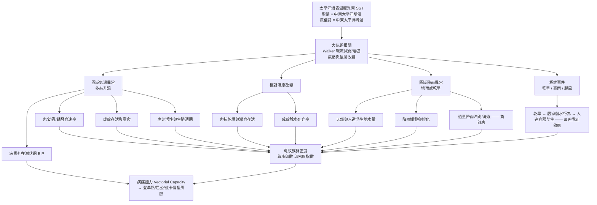

# 聖嬰現象（El Niño / ENSO）如何直接與間接影響環境因子，進而影響斑蚊族群與產卵數：學術文獻回顧

> **文獻來源聲明**：本文獻回顧所引用之生物醫學實證研究，均檢索自 **PubMed / PubMed Central**。所有引用之原始論文皆於文末「參考文獻」章節附上 DOI 連結，以標明原作者與出處。
>
> **主要病媒物種**：本文所稱「斑蚊」主要指埃及斑蚊（*Aedes aegypti*）與白線斑蚊（*Aedes albopictus*），二者為登革熱、屈公病（chikungunya）、茲卡病毒（Zika）與都市型黃熱病之主要病媒。

---

## 摘要

聖嬰－南方振盪（El Niño–Southern Oscillation, ENSO）是地球上跨年際尺度最強的氣候變異訊號。ENSO **並不直接**作用於斑蚊個體，而是透過一條「**海溫異常 → 大氣遙相關 → 區域天氣（溫度、降雨、濕度、乾旱）→ 斑蚊生活史各階段（卵、幼蟲、蛹、成蟲、產卵行為）→ 族群密度與病媒能力**」的因果鏈，間接調控斑蚊族群動態與產卵數。本文系統性整理此因果鏈的每一環節，並以來自台灣、南美洲（秘魯、哥倫比亞、委內瑞拉、巴西）、東南亞（印尼）、非洲與澳洲的實證研究支持各機制。核心結論為：**溫度**是驅動斑蚊發育速率、成蟲存活、產卵活性與病毒外在潛伏期的主導變數；**降雨**是雙面刃——適量降雨提供孳生地並觸發卵孵化，過量降雨則會沖刷幼蟲並淹沒產卵點；**乾旱**在許多地區反而因促進「居家儲水行為」而增加人造容器孳生源。ENSO 對斑蚊的影響具有顯著的**時間滯後（數週至數月）**、**非線性**與**區域依賴性**，此特性正是登革熱早期預警系統得以建立的基礎。

---

## 目錄

1. [概念架構：ENSO 影響斑蚊的因果鏈](#1-概念架構enso-影響斑蚊的因果鏈)
2. [ENSO 的物理機制與遙相關](#2-enso-的物理機制與遙相關)
3. [第一環節：ENSO → 區域環境因子](#3-第一環節enso--區域環境因子)
4. [第二環節：環境因子 → 斑蚊生活史與產卵](#4-第二環節環境因子--斑蚊生活史與產卵)
5. [綜合機制：病媒能力與外在潛伏期](#5-綜合機制病媒能力vectorial-capacity與外在潛伏期)
6. [區域實證案例](#6-區域實證案例)
7. [時間滯後與早期預警](#7-時間滯後lag與早期預警)
8. [調節因子：非線性、社會經濟與都市化](#8-調節因子非線性社會經濟與都市化)
9. [研究限制與未來方向](#9-研究限制與未來方向)
10. [結論](#10-結論)
11. [參考文獻](#11-參考文獻含-doi)

---

## 1. 概念架構：ENSO 影響斑蚊的因果鏈

ENSO 對斑蚊的作用是**階層式、間接性**的。可將整體機制拆解為下列因果鏈：

**關鍵觀念**：
- **直接影響（斑蚊層級）**：溫度、降雨、濕度等**局部天氣變數**直接作用於斑蚊的生理與行為。
- **間接影響（氣候層級）**：ENSO 本身是**上游氣候驅動力**，透過改變上述局部天氣變數而「間接」影響斑蚊——這也是文獻中反覆出現「ENSO 的效應主要透過局部溫度與降雨中介」的原因（Muñoz 等人於哥倫比亞的研究；Sci Rep 委內瑞拉研究）。

---

## 2. ENSO 的物理機制與遙相關

ENSO 是熱帶太平洋海洋－大氣耦合系統的振盪，具三個位相：**聖嬰（El Niño，暖位相）**、**反聖嬰（La Niña，冷位相）** 與**中性**。其強度常以**海洋尼諾指數（Oceanic Niño Index, ONI）** 量化。

根據 São Paulo 的貝氏時空研究（Lowe 團隊風格之階層模型），ENSO 被描述為「地球上最具影響力的大氣現象之一，其特徵為**海洋溫度變化、信風強度與大氣氣壓三者交互作用**，導致氣候條件的大範圍改變」（PLoS Negl Trop Dis, 10.1371/journal.pntd.0012397）。

聖嬰期間，中、東太平洋海表溫度升高，**Walker 環流減弱**，改變全球大氣的熱力與水氣輸送，透過「**遙相關（teleconnection）**」把太平洋的海溫異常訊號傳遞到遠處陸地，造成不同區域的溫度與降雨異常。值得注意的是：

- ENSO 效應具**區域異質性**——同一次聖嬰事件在不同地區可能表現為升溫增雨或升溫乾旱。
- ENSO 常與**印度洋偶極（Indian Ocean Dipole, IOD）** 共同作用；在南台灣的研究中，IOD 對局部氣候季節性的影響甚至大於 ENSO（PLoS One, 10.1371/journal.pone.0178698）。

因此，理解「ENSO → 斑蚊」必須先確認**該地在特定 ENSO 位相下的具體天氣反應**，不能一概而論。

---

## 3. 第一環節：ENSO → 區域環境因子

ENSO 透過遙相關改變下列對斑蚊有意義的環境因子：

### 3.1 溫度（升溫為主）

多數實證研究指出聖嬰位相伴隨**區域氣溫上升**：
- 印尼 Palembang 的登革大流行（1997 年底–1998 年）期間，ENSO 驅動的環境氣溫較常年高出 **+0.6 至 +1.2°C**，且此升溫在流行前數月即持續存在（Southeast Asian J Trop Med Public Health）。
- 委內瑞拉研究確認登革高峰多出現於「**較暖且較乾**」的聖嬰年（Sci Rep, 10.1038/s41598-018-24003-z）。
- 哥倫比亞研究以非線性因果分析（PCMCI）證實，聖嬰使登革病例增加「**主要由 ENSO 驅動的升溫與降雨減少所解釋**」（Acta Trop, 10.1016/j.actatropica.2021.106136）。

### 3.2 降雨（增雨或減雨，依區域而定）

ENSO 對降雨的影響方向具強烈區域性：
- 在南美安地斯與太平洋沿岸區，聖嬰常伴隨**降雨減少**（哥倫比亞、委內瑞拉）。
- 在秘魯沿海（Costa）與部分低地，聖嬰可帶來**異常豪雨**。
- 巴西 Recife 都會區研究指出，ENSO 造成的「**正溫度異常與降雨減少（源於海表溫度改變）**」為登革流行病學改變的部分成因（Rev Soc Bras Med Trop, 10.1590/0037-8682-0671-2021）。

### 3.3 乾旱與極端事件

聖嬰在部分地區與**嚴重乾旱**高度相關。波多黎各研究記錄到 2014–2015 年強聖嬰事件同時出現乾旱（J Med Entomol, 10.1093/jme/tjad053）。乾旱看似不利於需要水域孳生的斑蚊，但其**間接效應**（透過改變人類儲水行為）反而可能有利於斑蚊——詳見 4.4 節。

### 3.4 相對濕度

濕度隨溫度與降雨變化，並直接影響斑蚊卵的抗乾燥能力與成蟲脫水死亡率（見 4.3 節）。

---

## 4. 第二環節：環境因子 → 斑蚊生活史與產卵

斑蚊為**完全變態昆蟲**，生活史含卵→幼蟲→蛹→成蟲四階段，前三階段皆為水生。環境因子對各階段的作用如下。

### 4.1 溫度：主導性驅動變數

溫度是文獻中最一致、最強的斑蚊族群驅動因子，作用於**多個生活史環節**：

**(a) 卵與胚胎發育**
埃及斑蚊卵於產下時為白色，隨後迅速黑化；在 **28°C** 下胚胎發育約於 **60 小時**內完成初期、中期至末期分化。卵的絨毛膜（chorion）是重要的保護屏障（Parasit Vectors, 10.1186/s13071-021-05024-6）。溫度升高一般加速胚胎發育與孵化。

**(b) 幼蟲／蛹發育速率與成蟲體型**
在適溫範圍內升溫縮短幼蟲與蛹的發育時間，加快世代更替；但體型（vector size）通常隨溫度上升而縮小，間接改變叮咬率（Am J Trop Med Hyg, 10.4269/ajtmh.1997.57.285）。

**(c) 產卵活性（oviposition）**
多項田野研究以誘卵器（ovitrap）證實溫度與產卵正相關：
- 阿根廷中部研究：斑蚊產卵與「**前三週夜間溫度**」呈正相關（Med Vet Entomol, 10.1111/mve.12550）。
- 阿根廷 Córdoba 溫帶研究：**最低溫**與產卵活性正相關，低最低溫是產卵的限制因子（Acta Trop, 10.1016/j.actatropica.2020.105744）。
- 巴西 Paraná 沿海研究：**月均溫**對斑蚊產卵有顯著正影響（Trop Med Infect Dis, 10.3390/tropicalmed7090246）。
- 墨西哥 Morelos 研究：日均溫、相對濕度與降雨皆與**斑蚊卵密度**相關，且卵數與登革病例間存在 3–4 週時間滯後（Salud Publica Mex, 10.21149/8141）。

**(d) 溫度的非線性與上下限**
南台灣研究以分布滯後非線性模型（DLNM）顯示：**最低溫高於 23°C 或低於 17°C** 皆會提高登革發生率（滯後 10–15 週），說明溫度效應為**非線性**，存在最適區間（PLoS One, 10.1371/journal.pone.0178698）。São Paulo 研究則指出季節溫度**高於 23.30°C** 與幼蟲指數正相關（PLoS Negl Trop Dis, 10.1371/journal.pntd.0012397）。

**(e) 溫度對族群平衡的長期作用**
針對北美五城市（El Paso、New York、New Orleans、Orlando、Miami）的溫度依存族群動態模型顯示，溫度決定戶外族群能否維持存活平衡；在寒冷地區，即使成蚊在低溫期消失，**卵的存活**仍能讓族群在季節回暖後重新達到穩態（Bull Entomol Res, 10.1017/S0007485322000189）。

### 4.2 降雨：雙面刃效應

降雨對斑蚊具**正、負雙向**作用，方向取決於降雨量與孳生地類型：

**(a) 正效應——提供孳生地與觸發孵化**
- 適量降雨在天然與人造容器中積水，形成幼蟲棲地。中非喀麥隆跨緯度研究證實斑蚊豐度隨降雨增加（Parasit Vectors, 10.1186/s13071-025-06764-5）。
- 降雨可**觸發滯育／靜止卵的同步孵化**。改良的埃及斑蚊豐度模型顯示，納入「**降雨觸發卵孵化**」與「相對濕度對成蟲存活的影響」後，模型與監測資料及登革病例的吻合度顯著提升（J Med Entomol, 10.1093/jme/tjx077）。
- 中國廣州 11 年資料（PNAS）證實氣候透過「**降雨與溫度對蚊媒豐度與傳播率的作用**」驅動登革時間動態（PNAS, 10.1073/pnas.1618558114）。

**(b) 負效應——沖刷與淹沒產卵點**
- 阿根廷 Córdoba 研究提供了關鍵的反向證據：**每毫米累積雨量（4 週累積）與次週平均卵數下降 0.668 顆相關**。作者解釋，豪雨會把容器完全灌滿，反而**剝奪雌蚊的產卵基質（濕潤但非淹沒的壁面）**，迫使其另尋孳生地；同時強降雨會沖走既有幼蟲（Acta Trop, 10.1016/j.actatropica.2020.105744）。

**(c) 降雨效應在統計上可能被溫度「吸收」**
秘魯研究發現，**在調整溫度後，降雨對登革爆發風險已無顯著獨立效應**（溫度 RR 1.14/°C；降雨不顯著），凸顯溫度常是更主導的變數（PLoS Negl Trop Dis, 10.1371/journal.pntd.0010479）。

### 4.3 相對濕度：卵抗乾燥與成蟲存活

- 斑蚊卵具**抗乾燥（desiccation-resistant）** 特性，可在乾燥環境中以靜止／滯育狀態存活數週至數月，待再次浸水後孵化——此為斑蚊度過乾季與跨越不利季節的關鍵適應。
- 相對濕度直接影響**成蚊壽命**：高濕度降低成蟲脫水死亡率、延長存活，進而延長其感染與傳播病毒的時間窗。前述改良豐度模型即納入 RH 對成蟲存活的效應（J Med Entomol, 10.1093/jme/tjx077）。
- 紐奧良長期監測（2009–2016）顯示溫度、相對濕度與累積降雨對斑蚊產卵強度有立即或滯後的顯著關聯（J Med Entomol, 10.1093/jme/tjad007）。

### 4.4 乾旱的反直覺效應：儲水行為 → 人造容器孳生

這是 ENSO→斑蚊機制中最具政策意義、也最違反直覺的一環：

- 澳洲布里斯本研究記錄到，2000 年代初的長期乾旱促成「**儲水文化**」與限水法規，導致居民大量設置**雨水儲存桶（rainwater tanks）** 與各式儲水容器。調查顯示 **52.6% 住戶設有雨水桶、29.4% 以其他容器儲水**（1995 年調查時二者皆為零）；園藝用品、廢棄家用品與儲水容器合計占陽性容器的 66.2%、占所有未成熟蚊蟲的 77.5%（Int Health, 10.1093/inthealth/iht023）。
- 後續的空間網絡模型進一步顯示，這些因乾旱而生的未密封雨水桶會**提高斑蚊入侵的族群連通性與擴散**（Biol Invasions, 10.1007/s10530-021-02619-z）。

**因此，聖嬰引發的乾旱可能經由「人類行為中介」而不減反增斑蚊孳生源**。波多黎各研究亦觀察到，強聖嬰帶來的嚴重乾旱**並未壓低**埃及斑蚊族群（因其高度依賴人造容器而非天然雨水積水），而登革／屈公／茲卡病例與滯後 5–12 個月的 ONI、乾旱及斑蚊豐度呈正相關（J Med Entomol, 10.1093/jme/tjad053）。

---

## 5. 綜合機制：病媒能力（Vectorial Capacity）與外在潛伏期

上述所有環境因子最終匯聚於「**病媒能力**」——衡量蚊群傳播病原體效率的綜合指標。經典的 Jetten & Focks（1997）模型將溫度對下列參數的影響整合入病媒能力方程式（Am J Trop Med Hyg, 10.4269/ajtmh.1997.57.285）：

| 溫度影響的參數 | 升溫的效應 | 對傳播的意義 |
|---|---|---|
| 成蟲存活率 | 適溫延長、過高縮短 | 決定蚊能否活過潛伏期 |
| 生殖（gonotrophic）週期長度 | 縮短 | 加快叮咬與產卵頻率 |
| **病毒外在潛伏期（EIP）** | **縮短** | 蚊更快具傳染力，傳播效率大增 |
| 病媒體型（間接影響叮咬率） | 縮小 | 改變叮咬行為 |

模型推估：氣溫升高 **2°C** 即可能擴大登革傳播的**緯度與海拔範圍**，並延長溫帶地區的傳播季節。這說明 ENSO 的升溫效應不僅增加蚊「數量」，更透過**縮短 EIP** 提升每隻蚊的「傳播品質」——這是 ENSO 間接放大疫情的核心生物學路徑。

---

## 6. 區域實證案例

下表彙整不同地區 ENSO／氣候與斑蚊或登革關聯的代表性研究：

| 地區 | 主要發現 | ENSO/氣候中介 | 文獻（DOI） |
|---|---|---|---|
| **南台灣** | 最低溫 >23°C 或 <17°C、降雨提高登革率（滯後 10–20 週）；ENSO 與 IOD 造成非平穩年際變異，IOD 對季節性影響更大 | 溫度、降雨 | 10.1371/journal.pone.0178698 |
| **秘魯** | 溫度 RR 1.14/°C；ENSO（ICEN RR 1.17、ONI RR 1.04）顯著；效應受區域與季節調節 | 溫度為主 | 10.1371/journal.pntd.0010479 |
| **哥倫比亞** | 聖嬰↑／反聖嬰↓登革；主要由升溫與降雨減少解釋；12–16 月頻帶強共振 | 溫度↑、降雨↓ | 10.1016/j.actatropica.2021.106136 |
| **委內瑞拉** | 登革具 1 年與 3–4 年週期；高峰多在較暖較乾的聖嬰年 | 溫度↑、降雨↓ | 10.1038/s41598-018-24003-z |
| **巴西 São Paulo** | 聖嬰（≥1°C）使陽性容器數增加 1.30 單位；季雨 >153.12 mm、季溫 >23.30°C 與幼蟲指數正相關 | 溫度、降雨 | 10.1371/journal.pntd.0012397 |
| **巴西 Recife** | ENSO 使登革多年週期由 3–4 年短暫縮為 2–3 年；聖嬰年疫情區域同步擴散 | 溫度↑、降雨↓ | 10.1590/0037-8682-0671-2021 |
| **印尼 Palembang** | ENSO 驅動 +0.6~1.2°C 持續升溫，於流行前即推升病毒傳播 | 溫度↑ | Southeast Asian J Trop Med PH |
| **波多黎各** | 聖嬰伴隨嚴重乾旱但未壓低斑蚊族群；病例與滯後 5–12 月 ONI 正相關 | 乾旱、溫度、滯後 | 10.1093/jme/tjad053 |
| **喀麥隆（中非）** | 都市化與降雨提升埃及斑蚊豐度 | 降雨、都市化 | 10.1186/s13071-025-06764-5 |
| **澳洲布里斯本** | 乾旱促成儲水行為，人造容器成新孳生源 | 乾旱（經人類行為中介） | 10.1093/inthealth/iht023 |

**跨區共識**：ENSO 對斑蚊／登革的影響**方向與強度因地而異**，但**溫度幾乎普遍為正向且主導**，降雨方向依區域水文而定，乾旱效應則高度依賴當地儲水行為。

---

## 7. 時間滯後（Lag）與早期預警

ENSO→環境→斑蚊→疫情這條因果鏈的每一環都需要時間，因而累積出可觀的**時間滯後**，這是建立預警系統的關鍵：

- **ONI → 疫情**：波多黎各觀察到 **5–12 個月**的滯後（10.1093/jme/tjad053）。
- **氣候變數 → 登革**：南台灣為 **10–20 週**（溫度 10–15 週、降雨 10–20 週）（10.1371/journal.pone.0178698）。
- **卵數 → 病例**：墨西哥 Morelos 為 **3–4 週**（10.21149/8141）。

因此，**ONI 等 ENSO 指數可作為登革疫情的前導指標**。波多黎各研究明確建議「強聖嬰條件的出現可作為蟲媒疾病流行的早期預警訊號」，尤其在斑蚊豐度已超過密度閾值的地區（10.1093/jme/tjad053）。中國廣州研究則以前 8 年資料建模、成功預測後 3 年登革動態，證明氣候基礎預測的可行性（PNAS, 10.1073/pnas.1618558114）。

---

## 8. 調節因子：非線性、社會經濟與都市化

ENSO 對斑蚊的作用並非在真空中發生，而受多個**調節因子（effect modifiers）** 影響：

- **非線性與閾值**：溫度存在最適區間（如南台灣 17–23°C 邊界、São Paulo 23.30°C、降雨 153.12 mm 閾值），超出後效應反轉或趨緩。
- **社會經濟不平等**：São Paulo 研究發現社經差距（貧富不均）顯著促進斑蚊孳生，聖嬰效應在脆弱地區更強（10.1371/journal.pntd.0012397）。
- **都市化**：喀麥隆研究顯示都市化本身透過改變幼蟲棲地、微氣候與宿主可及性而提升埃及斑蚊豐度，並與氣候效應交互作用（10.1186/s13071-025-06764-5）。
- **病媒防治措施**：波多黎各研究指出，大規模誘捕（mass trapping）才是站點間斑蚊豐度差異的最主要因素，凸顯人為介入可**壓過**氣候訊號（10.1093/jme/tjad053）。
- **ENSO 效應的非平穩性**：哥倫比亞研究強調 ENSO–登革關係**隨時間改變、不可跨區外推**（10.1016/j.actatropica.2021.106136）。

---

## 9. 研究限制與未來方向

1. **相關 ≠ 因果**：多數研究為生態時間序列相關分析，難以完全排除混淆因子（如人口流動、病毒血清型輪替、免疫背景、防治政策）。
2. **區域外推困難**：ENSO 效應方向因地而異，單一地區模型不宜直接套用他區。
3. **社會行為中介被低估**：乾旱→儲水→孳生的行為路徑量化研究仍少，多集中於澳洲。
4. **未來氣候情境**：在全球暖化下，聖嬰事件的頻率與強度預期增加（10.1186/s40985-016-0035-2、10.1371/journal.pntd.0012397），可能放大 ENSO 對斑蚊與蟲媒疾病的衝擊。
5. **建議方向**：整合「ONI 等遙相關指數 + 局部天氣 + 誘卵器監測 + 社經與都市化圖層」的多層次早期預警模型；並針對台灣等 ENSO/IOD 共同作用區，釐清兩振盪的相對貢獻。

---

## 10. 結論

聖嬰現象（ENSO）**並非直接**作用於斑蚊，而是作為上游氣候驅動力，透過「**太平洋海溫異常 → 大氣遙相關 → 區域溫度／降雨／濕度／乾旱異常 → 斑蚊卵、幼蟲、成蟲與產卵行為 → 族群密度與病媒能力**」的階層式因果鏈，間接而顯著地形塑斑蚊族群與產卵數。綜合實證文獻，可歸納三項核心機制：

1. **溫度是主導變數**：升溫（在最適區間內）加速卵與幼蟲發育、提升產卵活性、縮短病毒外在潛伏期，全面放大族群成長與傳播效率；但效應為非線性，存在上下限。
2. **降雨是雙面刃**：適量降雨提供孳生地並觸發卵孵化，過量降雨則沖刷幼蟲、淹沒產卵基質而產生負效應；其獨立效應常被溫度統計性吸收。
3. **乾旱經由人類儲水行為反轉為正效應**：聖嬰引發的乾旱可能因居家儲水而增加人造容器孳生源，使高度依賴人造容器的埃及斑蚊族群不減反增。

這些機制共同具有**數週至數月的時間滯後**與**強烈的區域與社經依賴性**，此特性既是研究挑戰，也正是以 ONI 等 ENSO 指數建構登革熱早期預警系統的科學基礎。

---

## 11. 參考文獻（含 DOI）

> 依據 PubMed 使用規範，以下所有文獻均來自 PubMed / PubMed Central，並附 DOI 連結以標明原始出處與作者。

**ENSO / 氣候與斑蚊、登革之關聯**

1. Barrera R, et al. *El Niño Southern Oscillation (ENSO) effects on local weather, arboviral diseases, and dynamics of managed and unmanaged populations of* Aedes aegypti *in Puerto Rico.* J Med Entomol. [DOI](https://doi.org/10.1093/jme/tjad053)
2. *Impacts of El Niño Southern Oscillation on the dengue transmission dynamics in the Metropolitan Region of Recife, Brazil.* Rev Soc Bras Med Trop. [DOI](https://doi.org/10.1590/0037-8682-0671-2021)
3. *Effects of the El Niño-Southern Oscillation and seasonal weather conditions on* Aedes aegypti *infestation in the State of São Paulo (Brazil): A Bayesian spatio-temporal study.* PLoS Negl Trop Dis. [DOI](https://doi.org/10.1371/journal.pntd.0012397)
4. *Effects of local and regional climatic fluctuations on dengue outbreaks in southern Taiwan.* PLoS One. [DOI](https://doi.org/10.1371/journal.pone.0178698)
5. *The effect of weather and climate on dengue outbreak risk in Peru, 2000-2018: A time-series analysis.* PLoS Negl Trop Dis. [DOI](https://doi.org/10.1371/journal.pntd.0010479)
6. *Climatic factors associated with epidemic dengue in Palembang, Indonesia: implications of short-term meteorological events on virus transmission.* Southeast Asian J Trop Med Public Health.（PubMed 收錄，無 DOI）
7. Vincenti-Gonzalez MF, et al. *ENSO-driven climate variability promotes periodic major outbreaks of dengue in Venezuela.* Sci Rep. [DOI](https://doi.org/10.1038/s41598-018-24003-z)
8. Muñoz E, et al. *Spatiotemporal dynamics of dengue in Colombia in relation to the combined effects of local climate and ENSO.* Acta Trop. [DOI](https://doi.org/10.1016/j.actatropica.2021.106136)
9. Flahault A, et al. *Climate change and infectious diseases.* Public Health Rev. [DOI](https://doi.org/10.1186/s40985-016-0035-2)

**溫度、降雨、濕度對斑蚊生活史與產卵的作用**

10. *Aedes aegypti: egg morphology and embryonic development.* Parasit Vectors. [DOI](https://doi.org/10.1186/s13071-021-05024-6)
11. *Understanding the role of temporal variation of environmental variables in predicting* Aedes aegypti *oviposition activity in a temperate region of Argentina.* Acta Trop. [DOI](https://doi.org/10.1016/j.actatropica.2020.105744)
12. *Oviposition dynamics of* Aedes aegypti *in Central Argentina.* Med Vet Entomol. [DOI](https://doi.org/10.1111/mve.12550)
13. *Aedes aegypti and Aedes albopictus Oviposition Activity and the Associated Socio-environmental Factors in the New Orleans Area.* J Med Entomol. [DOI](https://doi.org/10.1093/jme/tjad007)
14. *Spatial and Temporal Distribution of Aedes Oviposition on the Coast of Paraná, Brazil.* Trop Med Infect Dis. [DOI](https://doi.org/10.3390/tropicalmed7090246)
15. *Temperature-dependent population dynamics for* Aedes aegypti *in outdoor, indoor, and enclosed habitats: a mathematical model for five North American cities.* Bull Entomol Res. [DOI](https://doi.org/10.1017/S0007485322000189)
16. *The effects of urbanization, temperature, and rainfall on* Aedes aegypti *and* Aedes albopictus *mosquito abundance across a broad latitudinal gradient in Central Africa.* Parasit Vectors. [DOI](https://doi.org/10.1186/s13071-025-06764-5)
17. *A rainfall- and temperature-driven abundance model for* Aedes albopictus *populations.* Int J Environ Res Public Health. [DOI](https://doi.org/10.3390/ijerph10051698)
18. *Association of dengue fever with* Aedes spp. *abundance and climatological effects.* Salud Publica Mex. [DOI](https://doi.org/10.21149/8141)
19. *Aedes aegypti Abundance Model Improved With Relative Humidity and Precipitation-Driven Egg Hatching.* J Med Entomol. [DOI](https://doi.org/10.1093/jme/tjx077)

**乾旱、儲水行為與人造容器孳生**

20. Trewin BJ, et al. *Increased container-breeding mosquito risk owing to drought-induced changes in water harvesting and storage in Brisbane, Australia.* Int Health. [DOI](https://doi.org/10.1093/inthealth/iht023)
21. Trewin BJ, et al. *Simulating an invasion: unsealed water storage (rainwater tanks) and urban block design facilitate the spread of the dengue fever mosquito in Brisbane, Australia.* Biol Invasions. [DOI](https://doi.org/10.1007/s10530-021-02619-z)

**病媒能力與氣候基礎預測**

22. Jetten TH, Focks DA. *Potential changes in the distribution of dengue transmission under climate warming.* Am J Trop Med Hyg. [DOI](https://doi.org/10.4269/ajtmh.1997.57.285)
23. *Climate variation drives dengue dynamics.* Proc Natl Acad Sci U S A (PNAS). [DOI](https://doi.org/10.1073/pnas.1618558114)

---

*本文件為文獻整理與回顧，內容係基於 PubMed / PubMed Central 檢索之公開學術論文摘要與詮釋，供研究參考之用；引用具體數據前，建議查閱各原始文獻全文以確認脈絡與方法。*
